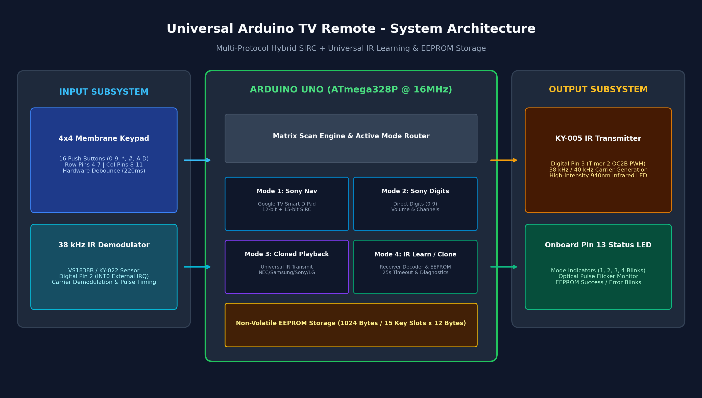
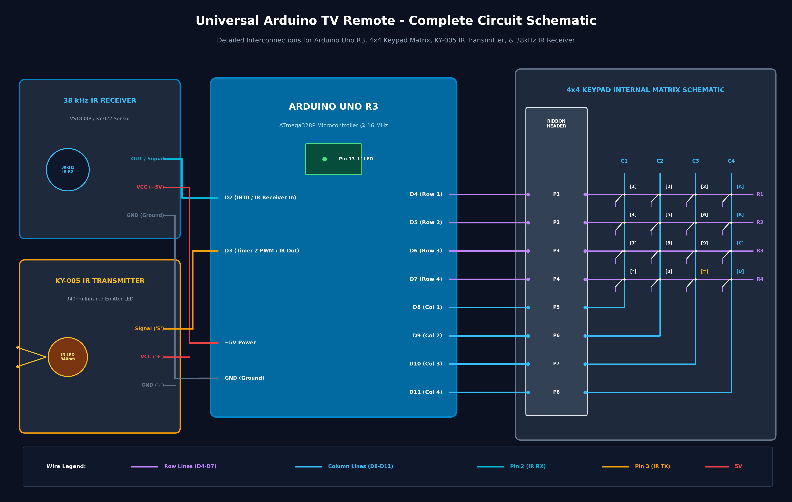
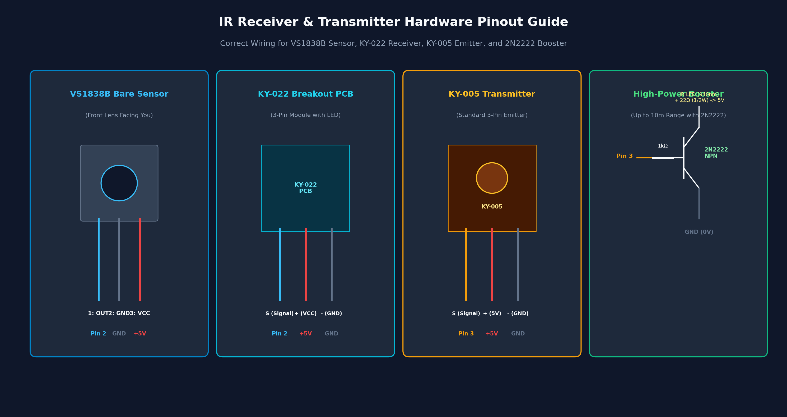
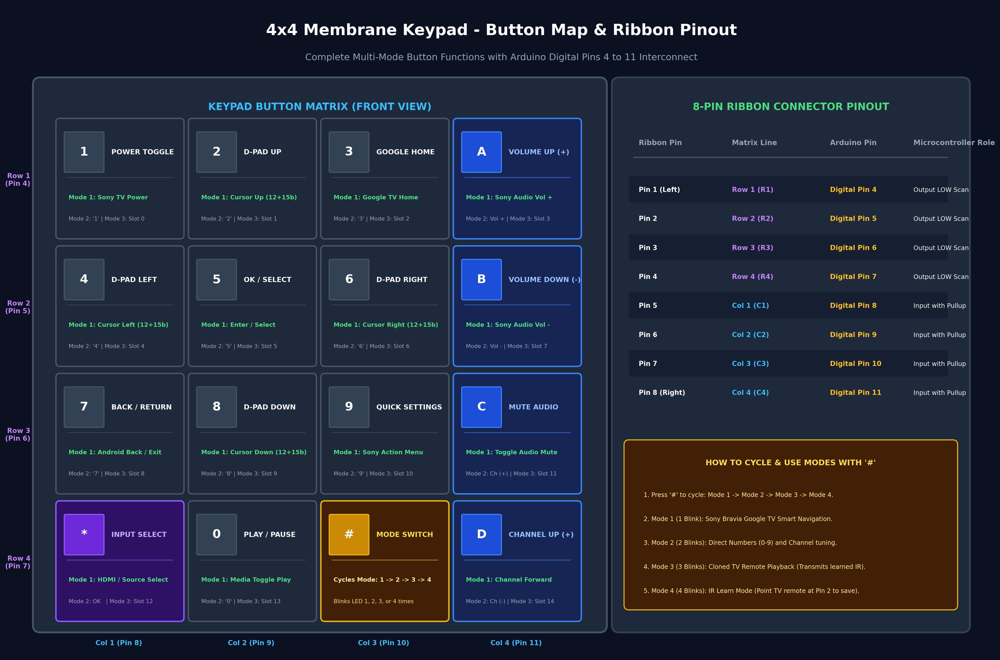
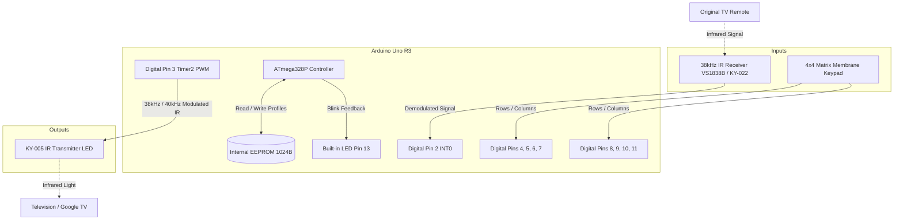
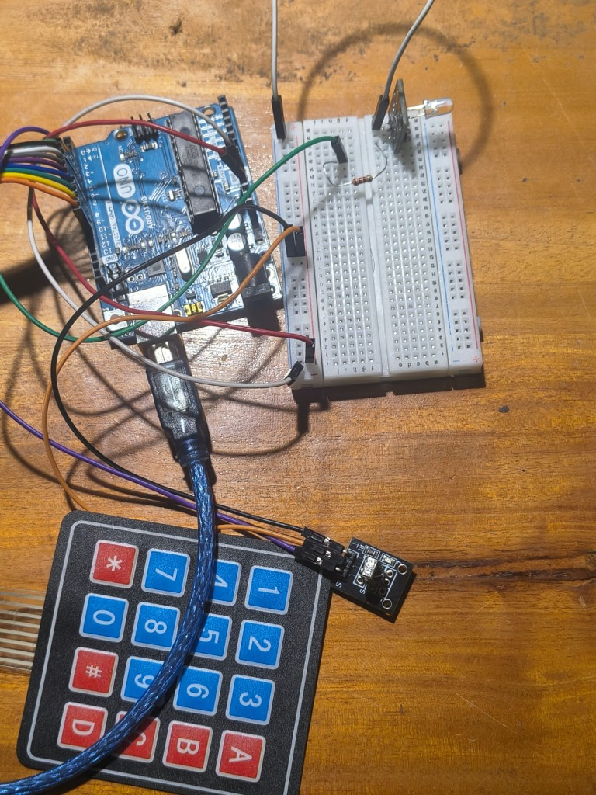
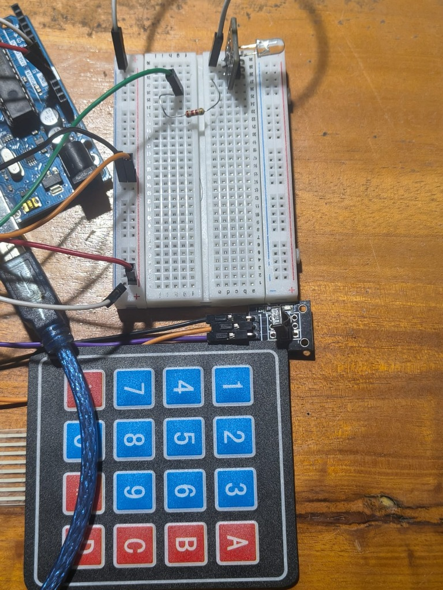
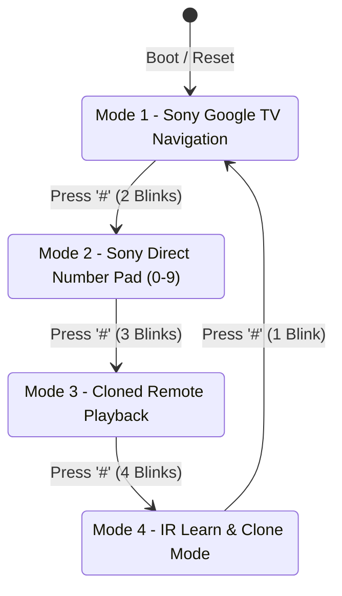
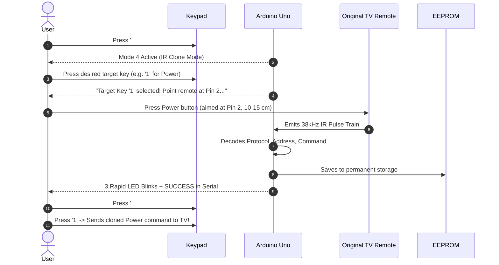
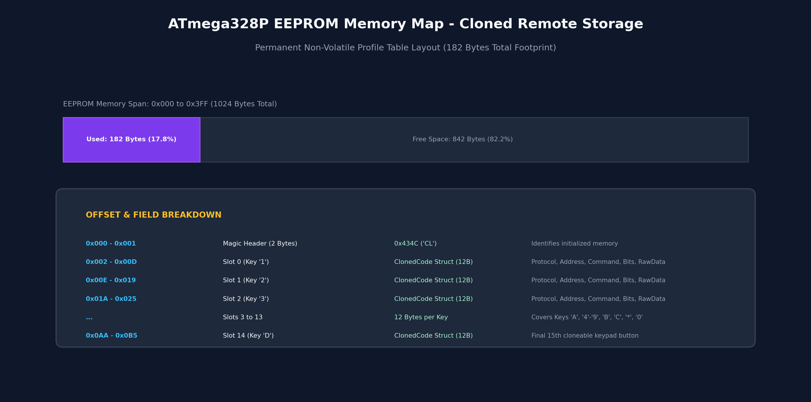

# Universal Arduino Multi-Mode & Learning TV Remote
**Full Technical Documentation & Hardware Reference Guide**

An advanced, multi-mode infrared (IR) remote controller built with **Arduino Uno (ATmega328P)**, a **4x4 Membrane Keypad**, a **KY-005 IR Transmitter (Pin 3)**, and a **38 kHz IR Demodulator Receiver (Pin 2)**.

The device combines factory-tuned **Sony Bravia Google TV Smart Navigation** with an onboard **Universal IR Clone / Learning Engine** backed by **non-volatile EEPROM persistence**.

---

## Table of Contents
1. [System Architecture & Features](#system-architecture--features)
2. [Hardware Components & Bill of Materials](#hardware-components--bill-of-materials)
3. [Circuit Schematic & Pin Connections](#circuit-schematic--pin-connections)
   - [Full Wiring Table](#full-wiring-table)
   - [IR Receiver (Pin 2) & Transmitter (Pin 3) Pinouts](#ir-receiver-pin-2--transmitter-pin-3-pinouts)
   - [4x4 Membrane Keypad Ribbon Cable](#4x4-membrane-keypad-ribbon-cable)
   - [Hardware Dataflow Block Diagram](#hardware-dataflow-block-diagram)
   - [Physical Hardware Prototype & Wiring Photos](#physical-hardware-prototype--wiring-photos)
4. [Operating Modes Overview](#operating-modes-overview)
5. [Keypad Button Mapping Reference](#keypad-button-mapping-reference)
   - [Mode 1: Sony Bravia Smart Navigation](#mode-1-sony-bravia-smart-navigation)
   - [Mode 2: Sony Bravia Number Pad (0–9)](#mode-2-sony-bravia-number-pad-09)
   - [Mode 3: Cloned TV Remote Playback](#mode-3-cloned-tv-remote-playback)
   - [Mode 4: IR Learning / Clone Mode](#mode-4-ir-learning--clone-mode)
6. [Step-by-Step User Guide](#step-by-step-user-guide)
   - [How to Clone a Button from an Original Remote](#how-to-clone-a-button-from-an-original-remote)
   - [How to Transmit Cloned Commands](#how-to-transmit-cloned-commands)
   - [Serial Monitor Commands (115200 Baud)](#serial-monitor-commands-115200-baud)
7. [EEPROM Storage Layout](#eeprom-storage-layout)
8. [Troubleshooting & Diagnostics](#troubleshooting--diagnostics)

---

## System Architecture & Features



- **Dual-Protocol Sony Bravia Smart Navigation (Mode 1)**: Fires both standard 12-bit SIRC and extended 15-bit Android/Google TV smart cursor commands simultaneously with optimal delays, ensuring full compatibility across both older Sony Bravia TVs and modern Google TV/Android TV units.
- **Universal IR Clone Engine (Modes 3 & 4)**: Learns signals from virtually any infrared TV remote (NEC, Samsung, Sony, LG, Panasonic, Philips RC5/RC6, Denon, Sharp, etc.).
- **Non-Volatile EEPROM Persistence**: Cloned buttons are saved directly to ATmega328P internal EEPROM. Learned profiles remain permanently stored even across power cuts and battery changes.
- **Safe Hardware Timer Management**: Manages ATmega328P Timer 2 so receiving and transmitting do not collide or trigger self-echoes.
- **Visual Feedback**: Onboard Pin 13 LED blinks distinct patterns for mode identification, flashes with incoming IR optical bursts, and confirms successful programming.

---

## Hardware Components & Bill of Materials

| Component | Quantity | Purpose | Recommendation / Part # |
| :--- | :---: | :--- | :--- |
| **Microcontroller** | 1 | Main Processor | Arduino Uno R3 (ATmega328P, 5V, 16 MHz) |
| **Keypad** | 1 | User Input Matrix | 4x4 Matrix Membrane Keypad (8-pin ribbon) |
| **IR Transmitter** | 1 | Emits 38/40 kHz IR commands | KY-005 IR LED Module (or 940nm IR LED + 220Ω resistor) |
| **IR Receiver** | 1 | Demodulates incoming IR | VS1838B / KY-022 / TSOP38238 (38 kHz Demodulator) |
| **Status LED** | 1 | Visual feedback & mode display | Arduino Uno built-in LED (Pin 13) |
| **Connecting Wires**| ~15 | Interconnects | Male-to-Female / Male-to-Male jumper wires |
| **Power Source** | 1 | Power Supply | 5V USB (Power bank / PC) or 9V battery on DC jack |

---

## Circuit Schematic & Pin Connections



### Full Wiring Table

| Module | Pin Label | Connected to Arduino Uno | Notes |
| :--- | :--- | :--- | :--- |
| **IR Receiver** | **OUT / S** | **Digital Pin 2** | External Interrupt INT0 (`INPUT_PULLUP`) |
| **IR Receiver** | **VCC / +** | **5V** | Regulated +5V supply |
| **IR Receiver** | **GND / -** | **GND** | Common Ground |
| **IR Transmitter (KY-005)** | **S (Signal)** | **Digital Pin 3** | Hardware Timer 2 PWM (OC2B) |
| **IR Transmitter (KY-005)** | **Middle / +** | **5V** | *(If using KY-005 module with onboard resistor)* |
| **IR Transmitter (KY-005)** | **- (Ground)** | **GND** | Common Ground |
| **Keypad Ribbon** | **Pin 1 (Row 1)** | **Digital Pin 4** | Keypad Row R1 (Keys 1, 2, 3, A) |
| **Keypad Ribbon** | **Pin 2 (Row 2)** | **Digital Pin 5** | Keypad Row R2 (Keys 4, 5, 6, B) |
| **Keypad Ribbon** | **Pin 3 (Row 3)** | **Digital Pin 6** | Keypad Row R3 (Keys 7, 8, 9, C) |
| **Keypad Ribbon** | **Pin 4 (Row 4)** | **Digital Pin 7** | Keypad Row R4 (Keys *, 0, #, D) |
| **Keypad Ribbon** | **Pin 5 (Col 1)** | **Digital Pin 8** | Keypad Column C1 (Keys 1, 4, 7, *) |
| **Keypad Ribbon** | **Pin 6 (Col 2)** | **Digital Pin 9** | Keypad Column C2 (Keys 2, 5, 8, 0) |
| **Keypad Ribbon** | **Pin 7 (Col 3)** | **Digital Pin 10**| Keypad Column C3 (Keys 3, 6, 9, #) |
| **Keypad Ribbon** | **Pin 8 (Col 4)** | **Digital Pin 11**| Keypad Column C4 (Keys A, B, C, D) |
| **Status Indicator** | **Onboard LED**| **Digital Pin 13** | Built-in 'L' LED |

---

### IR Receiver (Pin 2) & Transmitter (Pin 3) Pinouts



> [!CAUTION]
> Reversing VCC and GND on IR receiver sensors can permanently damage the sensor or cause extreme overheating. Verify your module type before powering on:
> - **VS1838B Bare Sensor**: Pin 1 (Left) = OUT (Pin 2), Pin 2 (Middle) = GND, Pin 3 (Right) = 5V.
> - **KY-022 Breakout Module**: `S` = Pin 2, `+` = 5V, `-` = GND.
> - **KY-005 Transmitter Module**: `S` = Pin 3, `+` = 5V, `-` = GND.

---

### 4x4 Membrane Keypad Ribbon Cable



Facing the keypad with the ribbon cable extending from the bottom:
- **Pins 1 to 4** (Left 4 pins): Row 1 to Row 4 $\rightarrow$ **Arduino Digital Pins 4, 5, 6, 7**
- **Pins 5 to 8** (Right 4 pins): Column 1 to Column 4 $\rightarrow$ **Arduino Digital Pins 8, 9, 10, 11**

---

### Hardware Dataflow Block Diagram



---

### Physical Hardware Prototype & Wiring Photos

Below are photographs of the actual physical hardware prototype assembly on the test bench, showing component placement, breadboard circuit, and module connections:


*Figure 1: Complete hardware prototype setup showing Arduino Uno R3, USB connection, mini breadboard with IR LED emitter, 4x4 matrix membrane keypad, and the 3-pin IR receiver module.*


*Figure 2: Close-up view showing the IR transmitter LED with current-limiting resistor on the breadboard, power rails, and the black IR receiver module connected via jumper wires.*

---

## Operating Modes Overview

The keypad key **`#`** is reserved as the global **Mode Selector**. Pressing **`#`** cycles through the four operating modes:



| Mode | Built-in LED Feedback | Mode Name | Description |
| :---: | :---: | :--- | :--- |
| **Mode 1** | **1 Blink** | **Sony Bravia Smart Navigation** | Controls Google TV / Android TV D-Pad, OK, Home, Back, Volume, Power, Mute, Input |
| **Mode 2** | **2 Blinks** | **Sony Bravia Number Pad** | Direct numeric input (`0`–`9`), Channel Up/Down, Volume Up/Down |
| **Mode 3** | **3 Blinks** | **Cloned TV Remote Playback** | Transmits stored infrared commands learned from your original remote (Samsung, LG, etc.) |
| **Mode 4** | **4 Blinks** | **IR Clone / Learning Mode** | Captures IR commands from an original remote via Pin 2 and stores them permanently in EEPROM |

---

## Keypad Button Mapping Reference

### Mode 1: Sony Bravia Smart Navigation
Optimized for streaming navigation, YouTube, Netflix, and Android/Google TV menus:

| Key | Function | Protocol & Command | Description |
| :---: | :--- | :--- | :--- |
| **`1`** | **Power Toggle** | Sony 12-bit (Addr `0x01`, Cmd `0x15`) | Turns TV On or Standby |
| **`2`** | **D-Pad UP** | 12-bit (`0x74`) + 15-bit (`0x4F`) | Moves cursor Up |
| **`3`** | **Google TV Home** | Sony 12-bit (Addr `0x01`, Cmd `0x60`) | Opens Google TV Home Screen |
| **`A`** | **Volume Up (+)** | Sony 12-bit (Addr `0x01`, Cmd `0x12`) | Increases volume |
| **`4`** | **D-Pad LEFT** | 12-bit (`0x34`) + 15-bit (`0x4D`) | Moves cursor Left |
| **`5`** | **OK / SELECT** | 12-bit (`0x65`) + 15-bit (`0x4C`) + `0x0B` | Selects / enters focused item |
| **`6`** | **D-Pad RIGHT** | 12-bit (`0x33`) + 15-bit (`0x4E`) | Moves cursor Right |
| **`B`** | **Volume Down (-)** | Sony 12-bit (Addr `0x01`, Cmd `0x13`) | Decreases volume |
| **`7`** | **Back / Return** | Sony 15-bit (Addr `0x97`, Cmd `0x23`) | Returns to previous screen / menu |
| **`8`** | **D-Pad DOWN** | 12-bit (`0x75`) + 15-bit (`0x50`) | Moves cursor Down |
| **`9`** | **Quick Settings** | Sony 15-bit (Addr `0x97`, Cmd `0x36`) | Opens Sony Settings / Action Menu |
| **`C`** | **Mute Audio** | Sony 12-bit (Addr `0x01`, Cmd `0x14`) | Toggles audio mute |
| **`*`** | **Input Select** | Sony 12-bit (Addr `0x01`, Cmd `0x25`) | Switches HDMI / TV Inputs |
| **`0`** | **Play / Pause** | Sony 15-bit (`0x1A` Play / `0x19` Pause)| Alternates Play and Pause on media |
| **`#`** | **Mode Switch** | Internal | Cycles to Mode 2 |
| **`D`** | **Channel Up (+)**| Sony 12-bit (Addr `0x01`, Cmd `0x10`) | Channel forward |

---

### Mode 2: Sony Bravia Number Pad (0–9)
For traditional live TV channel tuning and digit entry:

| Key | Function | Protocol & Command |
| :---: | :--- | :--- |
| **`1`** | Digit 1 | Sony 12-bit (Addr `0x01`, Cmd `0x00`) |
| **`2`** | Digit 2 | Sony 12-bit (Addr `0x01`, Cmd `0x01`) |
| **`3`** | Digit 3 | Sony 12-bit (Addr `0x01`, Cmd `0x02`) |
| **`A`** | Volume Up (+) | Sony 12-bit (Addr `0x01`, Cmd `0x12`) |
| **`4`** | Digit 4 | Sony 12-bit (Addr `0x01`, Cmd `0x03`) |
| **`5`** | Digit 5 | Sony 12-bit (Addr `0x01`, Cmd `0x04`) |
| **`6`** | Digit 6 | Sony 12-bit (Addr `0x01`, Cmd `0x05`) |
| **`B`** | Volume Down (-) | Sony 12-bit (Addr `0x01`, Cmd `0x13`) |
| **`7`** | Digit 7 | Sony 12-bit (Addr `0x01`, Cmd `0x06`) |
| **`8`** | Digit 8 | Sony 12-bit (Addr `0x01`, Cmd `0x07`) |
| **`9`** | Digit 9 | Sony 12-bit (Addr `0x01`, Cmd `0x08`) |
| **`C`** | Channel Up (+) | Sony 12-bit (Addr `0x01`, Cmd `0x10`) |
| **`*`** | OK / Confirm | Sony 12-bit (Addr `0x01`, Cmd `0x65`) |
| **`0`** | Digit 0 | Sony 12-bit (Addr `0x01`, Cmd `0x09`) |
| **`#`** | Mode Switch | Cycles to Mode 3 |
| **`D`** | Channel Down (-)| Sony 12-bit (Addr `0x01`, Cmd `0x11`) |

---

### Mode 3: Cloned TV Remote Playback
Transmits the learned command saved in EEPROM for the pressed button:

| Key | Cloned Slot | Default State | Behavior when Pressed |
| :---: | :---: | :---: | :--- |
| **`1`** | Slot 0 | Empty | Transmits learned signal for Key 1 |
| **`2`** | Slot 1 | Empty | Transmits learned signal for Key 2 |
| **`3`** | Slot 2 | Empty | Transmits learned signal for Key 3 |
| **`A`** | Slot 3 | Empty | Transmits learned signal for Key A |
| **`4`** | Slot 4 | Empty | Transmits learned signal for Key 4 |
| **`5`** | Slot 5 | Empty | Transmits learned signal for Key 5 |
| **`6`** | Slot 6 | Empty | Transmits learned signal for Key 6 |
| **`B`** | Slot 7 | Empty | Transmits learned signal for Key B |
| **`7`** | Slot 8 | Empty | Transmits learned signal for Key 7 |
| **`8`** | Slot 9 | Empty | Transmits learned signal for Key 8 |
| **`9`** | Slot 10 | Empty | Transmits learned signal for Key 9 |
| **`C`** | Slot 11 | Empty | Transmits learned signal for Key C |
| **`*`** | Slot 12 | Empty | Transmits learned signal for Key * |
| **`0`** | Slot 13 | Empty | Transmits learned signal for Key 0 |
| **`#`** | — | System Key | Cycles to Mode 4 |
| **`D`** | Slot 14 | Empty | Transmits learned signal for Key D |

> [!NOTE]
> If a button has not been cloned yet, pressing it in Mode 3 triggers **2 rapid error blinks** on Pin 13 LED and notifies in the Serial Monitor:
> `Key 'X' has not been cloned yet! Switch to Mode 4 (press '#') to learn it.`

---

### Mode 4: IR Learning / Clone Mode
Allows assigning any button from any remote to a keypad key:

| Action | Function | Feedback |
| :--- | :--- | :--- |
| **Press Keypad Key (`0`–`9`, `*`, `A`–`D`)** | Selects target slot to program | Serial confirmation; starts 25-second listening window |
| **Point Remote at Pin 2 & Press Button** | Receives, decodes, and saves IR signal | **3 rapid LED blinks**; saves to EEPROM |
| **Press `#`** | Exits learning; switches to Mode 1 | 1 LED blink |

---

## Step-by-Step User Guide

### How to Clone a Button from an Original Remote



1. **Cycle to Mode 4**: Press **`#`** until the onboard LED blinks **4 times** (Serial Monitor displays `SWITCHED TO MODE 4: IR Clone / Learning Mode`).
2. **Select Keypad Button**: Press the key you wish to program (for example, press `'1'` to make it Power, or `'A'` for Volume Up).
   - The Serial Monitor prints: `Target Key '1' selected for programming! Point original remote at Pin 2...`
3. **Capture Signal**: Aim your original remote 10–15 cm directly in front of the IR receiver on Pin 2 and press the desired button firmly once.
4. **Success Confirmation**:
   - The onboard Pin 13 LED will give **3 quick cheerful blinks**.
   - The Serial Monitor displays:
     ```text
     ==============================================================
     >>> [SUCCESS] KEY '1' HAS BEEN CLONED AND SAVED! <<<
     Protocol : SAMSUNG
     Address  : 0x0707
     Command  : 0x02
     Bits     : 32
     Permanently saved in EEPROM! You can now use it in Mode 3.
     ==============================================================
     ```
5. Repeat for any other buttons (`0`–`9`, `*`, `A`, `B`, `C`, `D`).
6. Press **`#`** to return to **Mode 3** to use your cloned remote.

---

### How to Transmit Cloned Commands
1. Press **`#`** until the onboard LED blinks **3 times** (Mode 3).
2. Point the KY-005 IR transmitter at your TV.
3. Press any of your cloned keys (`1`, `2`, `A`, etc.).
4. The Arduino transmits the learned protocol and command. The TV responds immediately!

---

### Serial Monitor Commands (115200 Baud)
Open your Arduino IDE Serial Monitor at **115200 Baud**:
- **Send `l` (List)**: Prints an organized summary table of all 15 key slots and their currently saved IR protocols, addresses, and commands.
- **Send `c` (Clear)**: Wipes all EEPROM slots back to factory defaults (unassigned) and flashes the LED 5 times.

---

## EEPROM Storage Layout



The ATmega328P microcontroller has **1,024 bytes** of internal EEPROM. Cloned buttons use a safe, packed structure occupying a total of **182 bytes** (only 17.8% of available EEPROM space).

Each key profile occupies only 12 bytes:
```cpp
struct ClonedCode {
  uint8_t  protocol;      // 1 byte:  decode_type_t (NEC, SONY, SAMSUNG, etc.)
  uint16_t address;       // 2 bytes: IR device address
  uint16_t command;       // 2 bytes: IR command code
  uint8_t  numberOfBits;  // 1 byte:  Bit length (12, 15, 20, 32, etc.)
  uint8_t  flags;         // 1 byte:  Protocol flags
  uint32_t rawData;       // 4 bytes: Raw decoded 32-bit data
  bool     isValid;       // 1 byte:  True if programmed
};
```
*Writes use `EEPROM.put()`, which only updates changed bytes to maximize EEPROM write endurance.*

---

## Troubleshooting & Diagnostics

### 1. Serial Monitor says: `[TIMEOUT] No valid IR signal was decoded`

#### Cause A: IR Receiver Pinout Mismatch
- Many 3-pin sensors look identical but have different pinouts.
- **VS1838B (facing front lens bump):** Pin 1 (Left) is **OUT**, Pin 2 (Middle) is **GND**, Pin 3 (Right) is **5V**.
- If Pin 1 and Pin 3 are swapped, the sensor receives no power and Pin 2 stays static.

#### Cause B: The Remote Uses Bluetooth or RF Instead of Infrared
- Many modern TV remotes (Fire TV, Roku, Apple TV, new Android TV remotes) use **Bluetooth** for standard buttons, and only use IR for TV Power and TV Volume.
- **Test:** Point your smartphone camera at the remote's front LED and press a button while watching the phone screen. If you see a **bright purple/pink flickering light**, it is an IR signal. If no light appears on any button, the remote is Bluetooth or batteries are dead.

#### Cause C: Receiver OUT Connected to the Wrong Pin
- Verify the wire connects to **Digital Pin 2 (D2)**, NOT Analog Pin A2.

---

### 2. Built-in LED Stays Solid ON
- In Mode 4, selecting a target key starts the 25-second waiting window. If you want to cancel, press **`#`** to switch to Mode 1.

### 3. TV Doesn't Respond to Cloned Signals
- IR transmitters are directional: ensure the clear LED bulb of the KY-005 transmitter points directly at the TV's IR sensor.
- The KY-005 onboard current-limiting resistor limits range to ~2–3 meters. For long-range operation (up to 10 meters), use the transistor driver circuit shown in the [Sensor Pinouts & Booster Diagram](images/sensor_pinouts.png).

### 4. Serial Monitor Shows Garbage Characters
- Ensure the baud rate dropdown in the bottom-right of the Arduino Serial Monitor is set to **`115200 baud`**.
