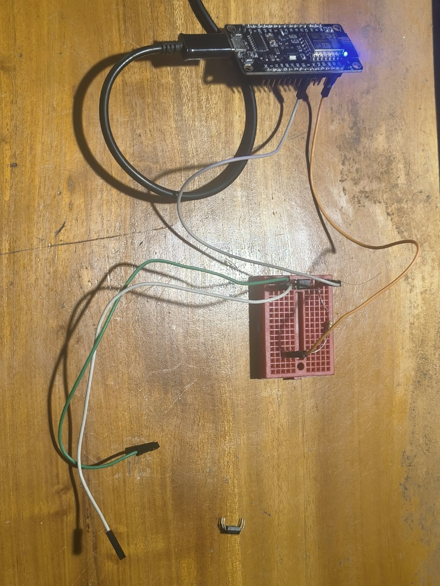
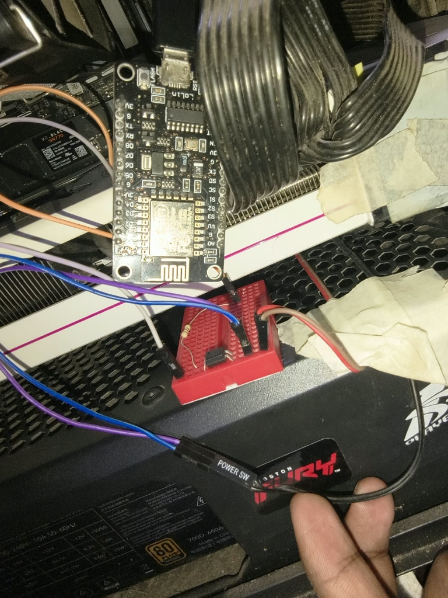
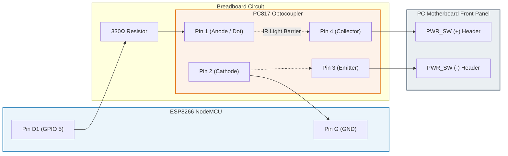
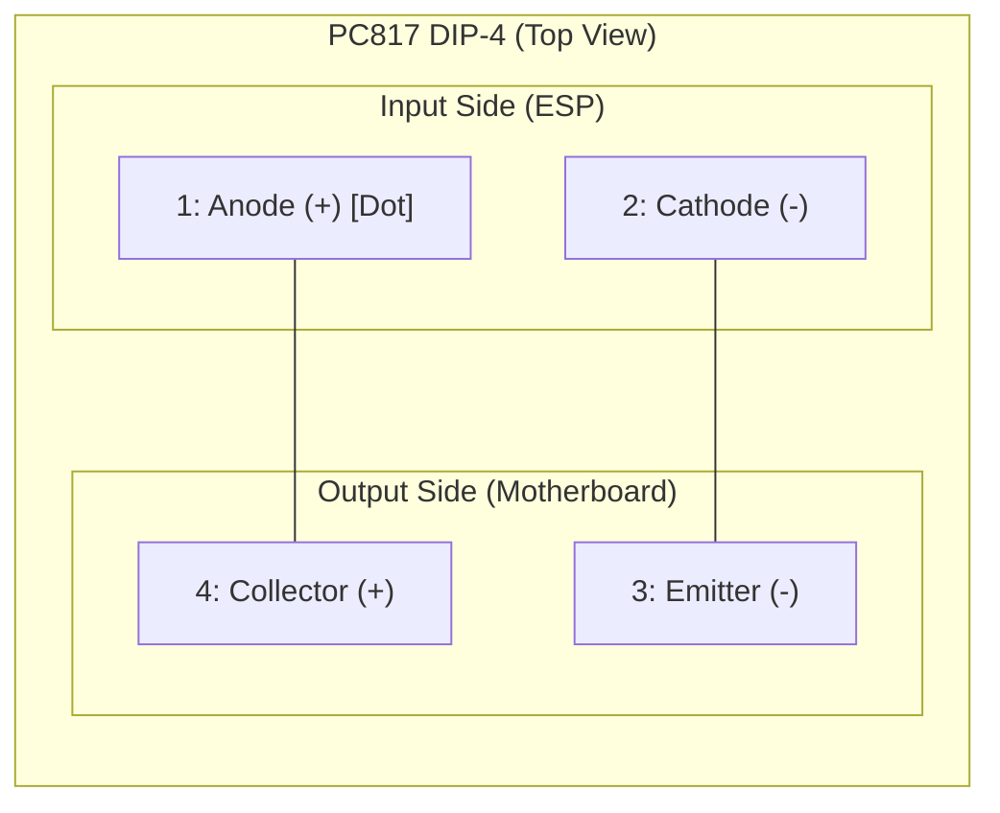

# IoT Remote PC Power Switch

Controls PC power remotely via ESP8266 and PC817 optocoupler, maintaining 100% electrical isolation.

---

## 1. Hardware Setup & Reference Photos

| Bench Test Setup | Chassis Installation |
| :---: | :---: |
|  |  |
| *NodeMCU, resistor, PC817 optocoupler & bench jumper leads* | *Installed inside PC case spliced with POWER SW header* |

---

## 2. Circuit Schematic



---

## 3. PC817 (817BN) Pinout



* **Pin 1 (Dot):** Connects to **D1 (GPIO 5)** via **330Ω resistor**.
* **Pin 2:** Connects to ESP8266 **GND**.
* **Pin 3:** Connects to Motherboard **PWR_SW -** (Ground).
* **Pin 4:** Connects to Motherboard **PWR_SW +** (Signal).

---

## 4. Wiring Quick Reference

| From | To | Component / Wire | Role |
| :--- | :--- | :--- | :--- |
| **ESP8266 D1 (GPIO 5)** | **PC817 Pin 1** | 220Ω–470Ω Resistor | Safe trigger signal |
| **ESP8266 GND** | **PC817 Pin 2** | Jumper wire | Return ground |
| **PC817 Pin 4** | **Motherboard PWR_SW (+)** | DuPont M-F | Collector (3.3V sense) |
| **PC817 Pin 3** | **Motherboard PWR_SW (-)** | DuPont M-F | Emitter (Motherboard GND) |

> **Why D1 (GPIO 5)?** D1 and D2 are boot-safe. Pins D0, D3, D4, and D8 glitch during boot or ESP reset, which would accidentally trigger your PC.

---

## 5. Firmware (`pc_on_iot.ino`)

```cpp
#define BLYNK_TEMPLATE_ID "TMPL6Hzn5xBxV"
#define BLYNK_TEMPLATE_NAME "PC Power Control"
#define BLYNK_AUTH_TOKEN "Your_Blynk_Auth_Token"

#define BLYNK_PRINT Serial
#include <ESP8266WiFi.h>
#include <BlynkSimpleEsp8266.h>

char ssid[] = "Your_WiFi_SSID";
char pass[] = "Your_WiFi_Password";

const int OPTO_PIN = 5; // D1 = GPIO 5
BlynkTimer timer;

// V0: 500ms Normal Press (Turn ON or Graceful Shutdown)
BLYNK_WRITE(V0) {
  if (param.asInt() == 1) {
    digitalWrite(OPTO_PIN, HIGH);
    timer.setTimeout(500L, []() {
      digitalWrite(OPTO_PIN, LOW);
      Blynk.virtualWrite(V0, 0);
    });
  }
}

// V1: 5.5s Emergency Hard Reset
BLYNK_WRITE(V1) {
  if (param.asInt() == 1) {
    digitalWrite(OPTO_PIN, HIGH);
    timer.setTimeout(5500L, []() {
      digitalWrite(OPTO_PIN, LOW);
      Blynk.virtualWrite(V1, 0);
    });
  }
}

void setup() {
  Serial.begin(115200);
  digitalWrite(OPTO_PIN, LOW); // Stay OFF during boot
  pinMode(OPTO_PIN, OUTPUT);
  Blynk.begin(BLYNK_AUTH_TOKEN, ssid, pass);
}

void loop() {
  Blynk.run();
  timer.run();
}
```

---

## 6. Configuration & Quick Checklist

1. **Blynk App:** Add Button widget $\to$ Datastream `V0` $\to$ Mode: **PUSH**.
2. **Motherboard BIOS:** Disable **ErP**, Enable **USB Power in Soft Off (S5)** (keeps ESP powered when PC is off).
3. **Windows Setting:** `Control Panel` $\to$ `Power Options` $\to$ `When I press the power button: Shut down`.
4. **Physical Button:** Connect in parallel with Pin 3 & Pin 4 using a DuPont Y-splitter if you want both case button & app control.
5. **Polarity Check:** If PC does not trigger, swap Pin 3 and Pin 4 jumpers on the motherboard header.
